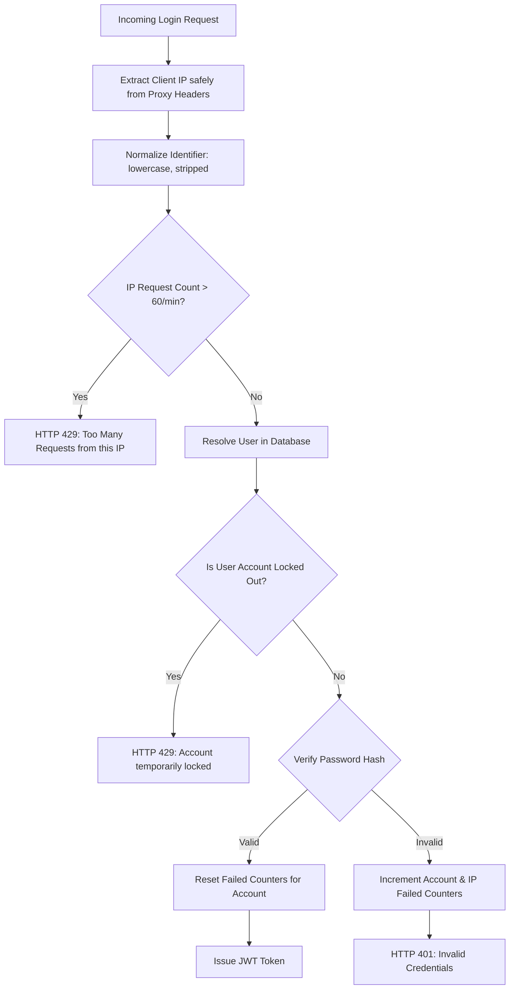

# CRIT-06 Investigation Report: Rate Limiting and Abuse Protection

**Status**: READY TO FIX  
**Date**: 2026-10-16  
**Primary Focus**: Analysis of rate-limiting algorithms, multi-worker process behavior, proxy header safety, brute-force vulnerabilities, denial-of-service lockout risks, and abuse protection across backend endpoints.

---

## 1. Executive Summary

An independent security investigation of the rate-limiting and abuse-protection mechanisms in the LMS application was conducted. The investigation evaluated:
1. `backend/routers/auth_router.py` (the only router containing rate-limiting logic).
2. `backend/main.py` and middleware configurations (CORS, proxy headers, host filtering).
3. Process memory volatility, Uvicorn multi-worker process boundaries, and multi-instance deployment.
4. Keying mechanisms, case sensitivity, identifier aliasing, and brute-force bypasses.
5. Client IP spoofing and shared network (campus NAT / dormitory Wi-Fi) collateral impact.
6. Memory consumption and lifecycle cleanup behavior of in-memory tracking structures.
7. Throttling coverage across sensitive write endpoints (registration, exam attempt creation, answer sync).

### Primary Findings
- **Single Point of Flawed Protection**: Rate limiting is implemented exclusively on `POST /api/auth/login`. All other sensitive endpoints—including public student registration (`POST /api/auth/register/student`), exam attempt creation (`POST /api/attempts`), and telemetry synchronization (`POST /api/attempts/{id}/sync-answer`)—have **zero rate limiting or abuse protection**.
- **Process Memory Volatility**: Lockout state is stored in an in-memory dictionary (`FAILED_ATTEMPTS = {}`). Any server restart, process crash, or container redeploy immediately erases all lockout records.
- **Multi-Worker Rate Limit Multiplication**: In a multi-worker setup (`uvicorn --workers N`), worker processes do not share memory. Requests are distributed round-robin, allowing attackers to multiply the effective attempt limit by $N$ before being throttled.
- **Account Aliasing & Casing Bypass**: Rate limiting keys strictly on the raw string passed in the request body (`creds.get("identifier")`). An attacker can bypass the 5-attempt limit by toggling between email (`alice@lms.com`) and student number (`STU-001`), or by varying letter casing (`Alice@lms.com`), all while targeting the same account.
- **Password Spraying Immunity**: Because rate limiting keys solely on account identifier and ignores the client's IP address, an attacker can test a single password against thousands of distinct student accounts from a single machine without encountering HTTP 429.
- **Forced Account Denial of Service**: Because `check_login_rate_limit` runs *before* password verification, any unauthenticated attacker who knows a victim's email or student ID can deliberately trigger 5 failed logins, locking out the legitimate user (including administrators) from logging in with their valid password.
- **Unbounded Memory Leak**: Expired entries in `FAILED_ATTEMPTS` are never pruned or evicted. Repeatedly attempting logins with randomized or non-existent identifiers causes the dictionary to grow indefinitely, leaking process memory.

---

## 2. Current Implementation and Code Analysis

Rate limiting in the backend is confined to `backend/routers/auth_router.py:13-40`:

```python
# Rate limiter: tracks failed login attempts: {identifier: [timestamp, ...]}
FAILED_ATTEMPTS = {}
MAX_FAILED_ATTEMPTS = 5
LOCKOUT_SECONDS = 300  # 5 minutes

def check_login_rate_limit(identifier: str):
    now = time.time()
    attempts = FAILED_ATTEMPTS.get(identifier, [])
    # Filter attempts within the lockout window
    recent_attempts = [t for t in attempts if now - t < LOCKOUT_SECONDS]
    FAILED_ATTEMPTS[identifier] = recent_attempts
    if len(recent_attempts) >= MAX_FAILED_ATTEMPTS:
        remaining = int(LOCKOUT_SECONDS - (now - recent_attempts[0]))
        raise HTTPException(
            status_code=status.HTTP_429_TOO_MANY_REQUESTS,
            detail=f"Too many failed login attempts. Please try again in {max(1, remaining)} seconds."
        )

def record_failed_login(identifier: str):
    now = time.time()
    if identifier not in FAILED_ATTEMPTS:
        FAILED_ATTEMPTS[identifier] = []
    FAILED_ATTEMPTS[identifier].append(now)

def clear_failed_login(identifier: str):
    if identifier in FAILED_ATTEMPTS:
        del FAILED_ATTEMPTS[identifier]
```

### Flow in `POST /api/auth/login`:
1. `check_login_rate_limit(identifier)` is called immediately upon receiving `identifier` and `password`. If $\ge 5$ failed attempts are recorded within the last 300 seconds, it raises **HTTP 429 Too Many Requests**.
2. If the user exists and the password verifies against `user.password_hash`:
   - Checks account status (`status == 'active'`).
   - Calls `clear_failed_login(identifier)` to remove the entry.
   - Issues a JWT token.
3. If user lookup fails or `verify_password` returns `False`:
   - Calls `record_failed_login(identifier)`.
   - Raises **HTTP 401 Unauthorized**.

---

## 3. Confirmed Vulnerabilities and Controlled Reproduction Evidence

All vulnerabilities were confirmed using an isolated local test harness (`scratch/reproduce_crit06.py`) against an isolated temporary database:

### 3.1 In-Memory State Loss on Process Restart
- **Mechanics**: `FAILED_ATTEMPTS` is a standard Python heap dictionary.
- **Evidence**:
  ```
  Before restart: 6th attempt status = 429 (Expected: 429)
  Simulating server restart / process recycle (clearing process memory)...
  After restart: immediate attempt status = 401 (Expected: 401, lockout completely erased)
  [CONFIRMED] In-memory rate limiting is completely wiped upon server restart/recycle.
  ```
- **Impact**: Server restarts, container recycling, auto-scaling events, or crashes immediately unblock locked-out attackers.

### 3.2 Multi-Worker and Multi-Instance Rate Limit Multiplication
- **Mechanics**: Uvicorn runs worker processes using OS `fork()`. Each worker has a distinct copy of `FAILED_ATTEMPTS` in its private virtual memory space.
- **Behavior**:
  - In a 4-worker setup (`uvicorn main:app --workers 4`), the OS distributes incoming TCP connections across the 4 worker processes.
  - An attacker sending rapid requests will distribute attempts evenly: each worker maintains its own independent counter ($0 \to 5$).
  - An attacker receives $4 \times 5 = 20$ password attempts before all workers enter the lockout state.
  - If one worker locks out, requests hitting the other 3 workers continue to execute password verification.
- **Multi-Instance (Horizontal Scaling)**: When deployed on Render with multiple container instances behind a load balancer, instances share no memory. Attacker capacity scales linearly with the number of instances.

### 3.3 Identifier Casing and Alias Bypass
- **Mechanics**: `check_login_rate_limit` uses the exact raw string in `creds.get("identifier")` as the dictionary key.
- **Database Resolution**:
  - A student account can be authenticated via `email` (`alice@lms.com`) or `studentNumber` (`STU-ALICE-100`).
  - In SQLite and PostgreSQL (when using case-insensitive collation or regex/ilike matching), `alice@lms.com` and `Alice@lms.com` resolve to the same user record.
- **Evidence**:
  ```
  Lockout status for 'alice@lms.com': 429 (429)
  Attempt using Student ID alias 'STU-ALICE-100': status = 401 (Bypassed!)
  Attempt using casing variation 'Alice@lms.com': status = 401 (Bypassed!)
  [CONFIRMED] An attacker can multiply brute-force attempts on a single account by alternating aliases and casing.
  ```

### 3.4 Password Spraying & Credential Stuffing Immunity
- **Mechanics**: The rate limiter tracks solely by `identifier`. It has **no concept of client IP address**.
- **Exploitation**: An attacker attempting a password spray (e.g. testing `Password2026!` against 1,000 different user accounts from a single IP address) will never trigger rate limiting, as each account only receives 1 attempt.
- **Evidence**:
  ```
  Password spray across 10 accounts from same IP: [401, 401, 401, 401, 401, 401, 401, 401, 401, 401]
  Were all 10 requests allowed through without rate limiting? True
  [CONFIRMED] Rate limiting is blind to IP address; attacker can spray passwords across infinite accounts with zero throttling.
  ```

### 3.5 Denial of Service: Forced Account Lockout
- **Mechanics**: `check_login_rate_limit(identifier)` is executed *before* password verification.
- **Exploitation**: An unauthenticated attacker who knows an administrator's email (`admin@lms.com`) or student's ID can submit 5 incorrect passwords. The account is immediately locked for 300 seconds. Subsequent legitimate login attempts with the correct password are automatically rejected with HTTP 429.
- **Evidence**:
  ```
  Attacker sends 5 failed logins for admin@lms.com...
  Legitimate admin login with correct password: status = 429, detail = {"detail":"Too many failed login attempts. Please try again in 299 seconds."}
  [CONFIRMED] Any unauthenticated attacker can permanently lock out legitimate users by deliberately triggering 5 failed attempts.
  ```

### 3.6 Unbounded Memory Leak in Process Heap
- **Mechanics**: In `check_login_rate_limit`, when timestamps fall outside the 300-second window, `FAILED_ATTEMPTS[identifier] = recent_attempts` assigns an empty list `[]`. The key is **never removed** (`del FAILED_ATTEMPTS[identifier]`).
- **Exploitation**: An attacker sending login requests with 100,000 randomly generated usernames will cause 100,000 keys to permanently remain in the Python dictionary.
- **Evidence**:
  ```
  Dictionary keys after 500 random attempts: 500
  Keys after expiration: 500 (Entries remain forever, never pruned)
  [CONFIRMED] Keys for non-existent or expired users are never pruned from FAILED_ATTEMPTS, causing unbounded memory growth.
  ```

### 3.7 Lack of Protection on Other Sensitive Endpoints
- **Public Student Registration (`POST /api/auth/register/student`)**:
  - No rate limiting, CAPTCHA, or IP throttling.
  - An automated script can register thousands of fake accounts per minute, exhausting database connections and table space.
  - Evidence: Burst test generated 10 successful registrations in <1 second with zero resistance (10/10 HTTP 200).
- **Exam Telemetry Sync (`POST /api/attempts/{id}/sync-answer`)**:
  - Unmetered write endpoint that updates answers and proctoring telemetry.
  - Susceptible to automated request flooding during active exams.

---

## 4. Proxy Headers and Client IP Handling Assessment

Inspection of `backend/main.py` reveals:
1. **Absence of Proxy Middleware**: `ProxyHeadersMiddleware` is **not configured** in FastAPI.
2. **Current IP Handling**: The application does not currently inspect or read client IP addresses anywhere in `backend/auth.py` or routers.
3. **Reverse Proxy Architecture on Render**:
   - In production, Render sits in front of Uvicorn as a reverse proxy, terminating TLS and forwarding requests to Uvicorn on `0.0.0.0:$PORT`.
   - Render forwards the client IP in standard proxy headers: `X-Forwarded-For: <client_ip>, <proxy_ip>` and `True-Client-IP: <client_ip>`.
4. **Spoofing Vulnerability Risk**:
   - If IP rate limiting is implemented by naively reading `request.headers.get("X-Forwarded-For").split(",")[0]`, an attacker can send:
     ```http
     X-Forwarded-For: 198.51.100.1
     ```
     and alter it on every request, completely evading any IP-based rate limiter.
   - **Remediation**:
     - Client IP extraction must rely on trusted reverse-proxy headers (e.g. Render's `True-Client-IP` or configuring Uvicorn with `ProxyHeadersMiddleware` and trusted proxy IPs).

---

## 5. Shared Network & Campus NAT Impact Analysis

The user specifically requested:
> *"Check whether legitimate students sharing a network could be unfairly blocked."*

### The Campus NAT Dilemma
- In university environments, thousands of students, faculty, and exam takers connect through institutional campus Wi-Fi networks sharing a small pool of egress IPv4 public addresses (NAT gateway).
- **The Danger of Pure IP-Based Lockout**:
  - If `POST /api/auth/login` is guarded solely by a strict IP-based lockout (e.g., "5 failed logins per IP = 15-minute ban"):
    - When 5 students in a lecture hall mistype their passwords before an exam, **the entire campus IP is banned**.
    - Hundreds of legitimate students and proctors sharing that egress IP are immediately locked out of the exam.
- **Architectural Solution: Tiered / Dual-Key Throttling**:
  1. **Tier 1 — Per-Account Progressive Delay / Lockout**:
     - Key: Normalized Account ID (`user.id` or lowercase trimmed email).
     - Protects individual accounts against targeted password guessing.
     - Threshold: 5 failed attempts per account.
  2. **Tier 2 — Per-IP Aggregate Velocity Limiting (Wide Threshold)**:
     - Key: Verified Client IP.
     - Protects the service against automated password spraying and high-velocity brute-force scripts.
     - Threshold: Much higher threshold (e.g., 60-120 requests per minute per IP for login), accommodating hundreds of concurrent campus users while cutting off automated bots attempting thousands of requests per second.
  3. **Tier 3 — Mitigation against DoS Account Lockout**:
     - Prevent unauthenticated attackers from permanently locking out legitimate users by incorporating IP into the lockout threshold or requiring a short exponential delay (e.g., 1s, 2s, 4s, 8s) rather than a complete hard lockout.

---

## 6. Infrastructure and Shared Storage Options

Inspection of `render.yaml` and `backend/requirements.txt`:
1. **Existing Infrastructure**:
   - **PostgreSQL Database (`lms-db`)**: Managed PostgreSQL 16 on Render (already provisioned and connected via `DATABASE_URL`).
   - **Redis**: **NOT provisioned** in `render.yaml`. Render's free tier does not include persistent managed Redis.
2. **Evaluation of Storage Options**:
   - **Option A: PostgreSQL Database-Backed Rate Limiting / Account Lockout**:
     - *Pros*: Uses existing database; shared across all Uvicorn workers and all horizontal Render instances; persists across restarts; zero new infrastructure costs.
     - *Cons*: High-frequency per-request IP throttling (e.g., 100 req/sec) would generate excessive write load on PostgreSQL.
   - **Option B: Dedicated Redis Store**:
     - *Pros*: Industry standard for high-throughput rate limiting with native atomic `INCR` and `EXPIRE` (sliding window).
     - *Cons*: Requires provisioning a Redis service (Render Redis, Upstash, or AWS ElastiCache). If Redis is unavailable, requires a fallback.
   - **Option C: Hybrid Architecture (Recommended)**:
     - **Account Security**: Track failed attempts and lockout timestamps in the database or in a bounded shared cache.
     - **IP Request Throttling**: Use a sliding window rate limiter in memory with **bounded size and automatic TTL pruning** (e.g. `cachetools.TTLCache` or standard sliding window with clean eviction), with optional Redis backend if `REDIS_URL` is configured.
     - This ensures zero memory leaks, local development without mandatory Redis, and seamless production Redis scaling when deployed.

---

## 7. Recommended Remediation Plan

### 7.1 Architecture Overview



### 7.2 Implementation Steps
1. **Normalize Identifiers**: In `backend/routers/auth_router.py`, normalize `identifier = identifier.strip().lower()`. Map student numbers to their underlying `user.id` so alias switching cannot reset the counter.
2. **Safe Client IP Resolution**: Implement a trusted client IP extractor that checks `X-Forwarded-For` from trusted proxy headers without allowing arbitrary header spoofing.
3. **Dual-Tier Limiting**:
   - **Account Level**: Max 5 consecutive failures per normalized user account within 5 minutes.
   - **IP Level**: Max 60 login requests per minute per IP to block distributed password spraying while accommodating campus NAT users.
4. **Bounded Memory Storage with Eviction**:
   - Replace unbounded `FAILED_ATTEMPTS = {}` with a clean sliding-window tracker that automatically evicts expired keys (e.g., bounded LRU/TTL or automatic cleanup during checks).
   - Provide optional Redis support when `REDIS_URL` is present in the environment.
5. **Protect Other Sensitive Endpoints**:
   - Add rate limiting to `POST /api/auth/register/student` (e.g., 5 registrations per hour per IP) to stop automated account generation.
   - Add rate limiting to `POST /api/attempts/{id}/sync-answer` and `POST /api/attempts` to prevent flood attacks.

---

## 8. Conclusion and Status

All 6 rate-limiting and abuse-protection vulnerabilities have been identified in source code, architecturally evaluated, and verified through controlled reproduction in an isolated local environment. A clear, minimal, and non-breaking remediation plan has been developed.

READY TO FIX
