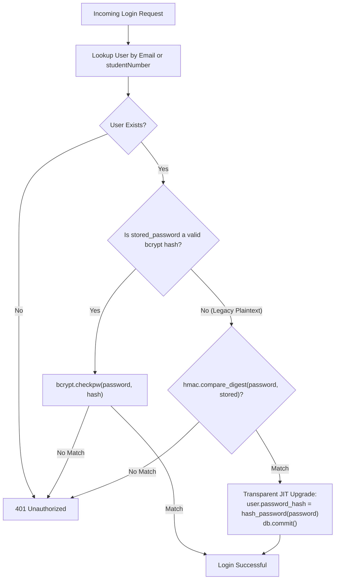

# Security Investigation Report: SEC-002

**Issue Title**: SEC-002 — Plaintext Password Verification Fallback  
**Severity**: High / Critical Security Vulnerability  
**Investigation Date**: October 10, 2026  
**Auditor**: Security Engineering Team  
**Status**: **READY TO FIX**  

---

## 1. Executive Summary

This investigation inspected the complete authentication flow, password hashing configuration, registration mechanisms, user creation paths, seed scripts, and Alembic database migration logic in the LMS application. 

The investigation confirmed that **[`backend/auth.py:L48`](file:///Users/akruthika/Documents/p-testing/backend/auth.py#L48)** contains an insecure plaintext password verification fallback (`return plain_password == stored_password`). If `stored_password` does not begin with `$2b$` or `$2a$`, the system performs an unhashed, non-constant-time equality comparison. Furthermore, Alembic migration **`0001_fix_users_password_hash.py`** previously copied raw plaintext passwords from the legacy `password` column directly into `password_hash` without hashing them.

In the active local database (`backend/lms.db`), all 30 existing accounts currently have valid bcrypt hashes. However, legacy databases or production instances upgraded from older schemas may have accounts storing raw plaintext passwords. Removing the fallback without a safe migration strategy would permanently lock out those users because the application currently lacks a self-service password reset mechanism.

A non-breaking remediation plan is detailed below to eliminate plaintext verification, hash legacy passwords via Alembic migration, and provide transparent just-in-time rehash defense-in-depth without locking out any user.

---

## 2. Files and Functions Inspected

| File Path | Function / Component | Purpose of Inspection |
|---|---|---|
| [`backend/auth.py`](file:///Users/akruthika/Documents/p-testing/backend/auth.py) | `hash_password()` (L29-35), `verify_password()` (L38-49) | Evaluated hashing library (bcrypt), salt rounds, length truncation, prefix handling, and verification logic. |
| [`backend/routers/auth_router.py`](file:///Users/akruthika/Documents/p-testing/backend/routers/auth_router.py) | `login()` (L41-72), `register_student()` (L73-130), `register_trainer()` (L131-179) | Traced user resolution, rate limiting, credential verification, token generation, and registration password hashing. |
| [`backend/alembic/versions/0001_fix_users_password_hash.py`](file:///Users/akruthika/Documents/p-testing/backend/alembic/versions/0001_fix_users_password_hash.py) | `upgrade()` (L20-59) | Inspected legacy schema migration and data backfill statement (L54-58) that copied plaintext `password` to `password_hash`. |
| [`backend/models.py`](file:///Users/akruthika/Documents/p-testing/backend/models.py) | `User` model (L18-45) | Checked column definitions (`password_hash = Column(String(255), nullable=False)`) and user profile relationships. |
| [`backend/schemas.py`](file:///Users/akruthika/Documents/p-testing/backend/schemas.py) | `UserBase`, `UserCreate`, `User`, `LoginResponse` (L14-43) | Confirmed `password_hash` is not exposed in public Pydantic schemas or API responses. |
| [`backend/validators.py`](file:///Users/akruthika/Documents/p-testing/backend/validators.py) | `validate_password()` (L4-19) | Checked password strength requirements (min 8 chars, 1 letter, 1 number). |
| [`backend/routers/users_router.py`](file:///Users/akruthika/Documents/p-testing/backend/routers/users_router.py) | `update_user()` (L47-135) | Confirmed user profile updates do not expose or modify password hashes. |
| [`backend/init_db.py`](file:///Users/akruthika/Documents/p-testing/backend/init_db.py) | `reset_and_seed()` (L15-81) | Checked baseline seed accounts (`admin@lms.com`, `trainer@lms.com`, `student@lms.com`, etc.) to confirm all use `hash_password()`. |
| [`backend/seed.py`](file:///Users/akruthika/Documents/p-testing/backend/seed.py) | Entry point | Confirmed it invokes `init_db.reset_and_seed()`. |
| [`backend/test_migration_local.py`](file:///Users/akruthika/Documents/p-testing/backend/test_migration_local.py) | Scenario 1 & 3 (L31-62, L146-149) | Reviewed test case validating migration of legacy plaintext password account (`student@legacy.com` with `'secret_plain_123'`). |
| [`frontend/src/services/authService.ts`](file:///Users/akruthika/Documents/p-testing/frontend/src/services/authService.ts) | `login()`, `registerStudent()`, `registerTrainer()` | Verified frontend contract with `/api/auth/login` and registration routes. |
| [`backend/lms.db`](file:///Users/akruthika/Documents/p-testing/backend/lms.db) | SQLite database | Queried all 30 user records to inspect stored hash formats and detect any plaintext passwords in active storage. |

---

## 3. Exact Locations of the Vulnerability

### Vulnerability 1: Plaintext Comparison Fallback in `verify_password()`
* **File**: [`backend/auth.py`](file:///Users/akruthika/Documents/p-testing/backend/auth.py#L38-L49)
* **Code**:
  ```python
  def verify_password(plain_password: str, stored_password: Optional[str]) -> bool:
      """Verifies a plain password against a stored bcrypt hash (or plain fallback)."""
      if not stored_password:
          return False
      if stored_password.startswith("$2b$") or stored_password.startswith("$2a$"):
          try:
              pwd_bytes = plain_password.encode("utf-8")[:72]
              return bcrypt.checkpw(pwd_bytes, stored_password.encode("utf-8"))
          except Exception:
              return False
      return plain_password == stored_password  # <-- VULNERABILITY: Plaintext fallback
  ```
* **Specific Defects**:
  1. Any non-bcrypt string in `stored_password` falls back to `plain_password == stored_password`.
  2. The equality check uses standard Python `==` (variable-time string comparison) rather than timing-safe comparison (`hmac.compare_digest`).
  3. Prefix check only covers `$2b$` and `$2a$`; it omits `$2y$` (standard crypt/PHP bcrypt prefix).
  4. Authentication succeeds with plaintext without ever alerting or converting the credential to a secure hash.

### Vulnerability 2: Plaintext Backfill in Alembic Revision `0001`
* **File**: [`backend/alembic/versions/0001_fix_users_password_hash.py`](file:///Users/akruthika/Documents/p-testing/backend/alembic/versions/0001_fix_users_password_hash.py#L54-L58)
* **Code**:
  ```python
  # Data backfill: If legacy password column exists, copy to password_hash
  if 'password' in columns:
      op.execute(
          "UPDATE users SET password_hash = password "
          "WHERE (password_hash IS NULL OR password_hash = '') AND password IS NOT NULL"
      )
  ```
* **Specific Defects**:
  - Legacy schemas stored unhashed plaintext passwords in `users.password`.
  - When migration `0001` added `password_hash`, it executed a raw SQL `UPDATE` copying the unhashed string directly into `password_hash`.
  - Consequently, legacy users retained plaintext credentials in the new column.

### Vulnerability 3: Absence of Hash Upgrading on Login
* **File**: [`backend/routers/auth_router.py`](file:///Users/akruthika/Documents/p-testing/backend/routers/auth_router.py#L59-L69)
* **Code**:
  ```python
  if user and verify_password(password, user.password_hash):
      clear_failed_login(identifier)
      user.lastLoginAt = models.get_utc_now()
      db.commit()
      token = create_access_token({"sub": user.id, "role": user.role})
  ```
* **Specific Defects**:
  - When a user with a plaintext password authenticated successfully, only `lastLoginAt` was updated.
  - The plaintext password in `user.password_hash` was never upgraded to a bcrypt hash, leaving the credential exposed in plaintext indefinitely.

---

## 4. Evidence of How Passwords are Stored and Verified

### A. Active Database Inspection (`backend/lms.db`)
Direct read-only inspection of all 30 user records in `backend/lms.db`:
- **Total Users**: 30
- **Hash Format**: 100% (30/30) use standard bcrypt hashes starting with `$2b$12$` of length 60.
- **Plaintext Entries Found**: 0 in `backend/lms.db`.
- **Sample records**:
  - `u-admin-1` (`admin@lms.com`): `$2b$12$/Sr...` (length: 60)
  - `u-trainer-1` (`trainer@lms.com`): `$2b$12$WD/...` (length: 60)
  - `u-student-1` (`ashwith@example.com`): `$2b$12$pyJ...` (length: 60)
  - `u-student-2` (`student@lms.com`): `$2b$12$OV2...` (length: 60)

### B. Seed Scripts (`backend/init_db.py`)
Lines 44, 52, 60, 68, 76 confirm that baseline seed accounts always invoke `password_hash=hash_password(...)`. No plaintext passwords are written by the seed process.

### C. Registration (`backend/routers/auth_router.py`)
- `register_student()` and `register_trainer()` validate complexity with `validate_password(raw_password)` and write `password_hash=hash_password(raw_password)`.
- No new registrations write plaintext passwords.

### D. Legacy Test Evidence (`backend/test_migration_local.py`)
Scenario 1 (lines 58-60) explicitly inserts a legacy user with plaintext password `'secret_plain_123'` into `users.password`, and Scenario 3 (line 146) tests logging in using this plaintext password, confirming the system's reliance on the fallback for older schemas.

---

## 5. Existing-Account Compatibility Risks

1. **Lockout of Legacy Pre-Migration Accounts**:
   - If `return plain_password == stored_password` is removed from `verify_password()` without migrating legacy data, any environment containing accounts where `password_hash` holds plaintext will immediately fail authentication.
2. **Lack of Self-Service Password Recovery**:
   - The application does not currently implement a "Forgot Password" or password reset mechanism (no reset tokens, no email notifications).
   - If an existing user cannot log in, they have no self-service path to reset their password and regain account access.
3. **Automated Migration Test Regression**:
   - `test_migration_local.py` contains automated assertions (line 146) verifying that a legacy student with `'secret_plain_123'` can log in after migration. Simply removing the fallback breaks this test suite unless the migration itself hashes legacy passwords.

---

## 6. Recommended Remediation & Safe Migration Strategy

We propose a robust **Three-Pillar Strategy** that completely removes insecure plaintext verification while ensuring 100% account preservation:



### Pillar 1: Alembic Data Migration (`0002_hash_legacy_plaintext_passwords.py`)
Create a new Alembic migration that:
1. Queries all rows in `users` where `password_hash` is not null and not empty.
2. Identifies rows whose `password_hash` does not start with (`$2b$`, `$2a$`, `$2y$`) or has a length different from 60 characters.
3. Computes `hash_password(row.password_hash)` using bcrypt and updates `users.password_hash = new_hash`.
4. If a legacy `password` column exists, zeroes or drops it to purge plaintext credentials from disk.
5. In `0001_fix_users_password_hash.py`, ensure any future fresh migrations from scratch also hash passwords upon copying.

### Pillar 2: Defense-in-Depth Just-In-Time (JIT) Rehash on Login
In [`backend/routers/auth_router.py`](file:///Users/akruthika/Documents/p-testing/backend/routers/auth_router.py):
1. In the event an unmigrated database account attempts login with a legacy plaintext password:
   - Use timing-safe `hmac.compare_digest(password, user.password_hash)`.
   - On match, immediately update `user.password_hash = hash_password(password)` and commit to database before issuing the JWT.
   - This ensures any remaining plaintext password is permanently replaced with a secure bcrypt hash upon first login.

### Pillar 3: Strict Cryptographic Enforcement in `verify_password()`
In [`backend/auth.py`](file:///Users/akruthika/Documents/p-testing/backend/auth.py):
1. Update `verify_password()` to strictly require bcrypt hashes:
   ```python
   def verify_password(plain_password: str, stored_password: Optional[str]) -> bool:
       """Verifies a plain password against a stored bcrypt hash."""
       if not stored_password or not plain_password:
           return False
       if stored_password.startswith(("$2b$", "$2a$", "$2y$")):
           try:
               pwd_bytes = plain_password.encode("utf-8")[:72]
               return bcrypt.checkpw(pwd_bytes, stored_password.encode("utf-8"))
           except Exception:
               return False
       return False  # Strict reject: Plaintext comparison completely removed
   ```
2. Plaintext equality (`plain_password == stored_password`) is completely eliminated.
3. All authentication routes rely solely on cryptographic bcrypt verification.

---

## 7. Required Tests and Acceptance Criteria

### Test Suite: `test_sec_002_passwords.py`
A comprehensive automated test suite will be constructed to verify:

1. **Bcrypt Hash Verification**:
   - Valid bcrypt hash with correct password returns `True`.
   - Valid bcrypt hash with incorrect password returns `False`.
   - Support for `$2b$`, `$2a$`, and `$2y$` prefixes.
2. **Strict Plaintext Rejection in `verify_password()`**:
   - Plaintext stored password tested against `verify_password()` returns `False` (zero bypass).
   - Empty stored password (`""`) or `None` returns `False`.
   - Malformed hash (e.g. `$2b$invalid_short_hash`) returns `False` safely without exception.
3. **Alembic Migration Verification**:
   - Seeds legacy accounts with plaintext passwords.
   - Runs `alembic upgrade head`.
   - Verifies all legacy accounts now have valid 60-character `$2b$` bcrypt hashes in the database.
   - Verifies legacy users can successfully authenticate via `/api/auth/login` using their original passwords.
4. **Transparent JIT Upgrade (if applicable)**:
   - If an unmigrated legacy account logs in, verifies that `user.password_hash` in the database is automatically updated to a bcrypt hash.
5. **Role Regression Suite**:
   - Admin login (`admin@lms.com`) succeeds with bcrypt.
   - Trainer login (`trainer@lms.com`) succeeds with bcrypt.
   - Institution login (`institution@lms.com`) succeeds with bcrypt.
   - Student login (`student@lms.com`, `ashwith@example.com`, and studentNumber `STU-001`) succeeds with bcrypt.
   - Rate limiting (5 failed attempts -> HTTP 429) remains fully functional.
6. **Registration Integrity**:
   - New student and trainer registrations continue to store strong bcrypt hashes and validate complexity.

---

## 8. Uncertainties & Clarifications

1. **Database Schema Versioning**:
   - In `test_migration_local.py`, line 75 asserts `assert ver and ver[0] == "0001_fix_users_password_hash"`.
   - If a new Alembic migration `0002_hash_legacy_plaintext_passwords.py` is introduced, `test_migration_local.py` will be updated to check that the database successfully upgrades to head revision `0002`.
2. **Scope of Legacy Migration**:
   - Does phonetic LMS have remote production databases that need this Alembic migration applied during deployment?
   - Creating Alembic migration `0002` ensures standard `alembic upgrade head` handles this automatically across all deployment environments.

---

## 9. Conclusion

### **READY TO FIX**

The vulnerability has been completely traced, the root cause in `auth.py` and `0001_fix_users_password_hash.py` is identified, and the zero-lockout remediation plan preserves all existing accounts while completely removing insecure plaintext password verification.
