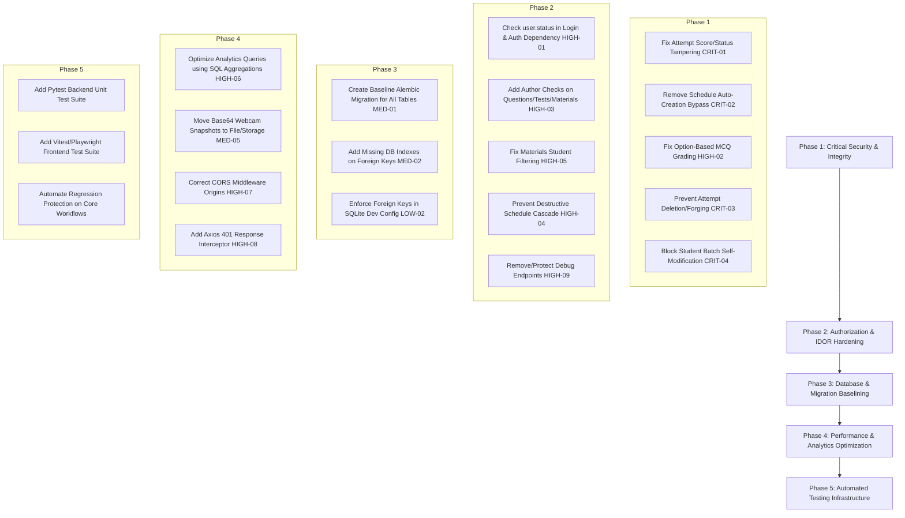

# Comprehensive Code-Quality, Security, Reliability, and Maintainability Audit

**Target System**: LMS (Learning Management System)  
**Audit Date**: October 13, 2026  
**Scope**: Entire codebase (`backend/`, `frontend/`, root configuration, migrations, test suites)  
**Priority**: Codebase Production-Readiness (Non-deployment focus)  
**Audit Mode**: Read-only verification of active source code, dependencies, architecture, and tests

---

## 1. Executive Summary and Overall Risk Assessment

### 1.1 Executive Summary
A full-scope, independent audit was performed on the LMS project to evaluate production readiness across security, reliability, data integrity, code quality, test coverage, and maintainability. This audit inspected active source code across the FastAPI backend, React/Vite frontend, SQLAlchemy models, Alembic migrations, configuration files, and automated test scripts.

Recent targeted security initiatives successfully resolved two major vulnerabilities:
- **SEC-001 (Confirmed Fixed)**: Test question answer leakage, explanation disclosure, and test authorization bypasses in active exam endpoints have been eliminated. Active student endpoints correctly sanitize correct answers, explanations, and option correctness flags, and validate student schedule and batch assignments.
- **SEC-002 (Confirmed Fixed)**: Insecure plaintext password comparison fallbacks in `backend/auth.py` have been completely removed. Passwords strictly verify via bcrypt hashes, invalid formats fail safely, and Alembic migration `0002` safely migrated legacy plaintext accounts.
- **Render Migration Command (Confirmed Implemented)**: The startup command in `render.yaml` executes Alembic migrations prior to starting the Uvicorn web server.

However, the comprehensive audit uncovered **critical business-logic vulnerabilities, authorization bypasses, exam integrity flaws, and architectural scalability blockers** that make the codebase **NOT YET PRODUCTION-READY**.

### 1.2 Overall Risk Assessment: HIGH / CRITICAL

| Risk Domain | Current Rating | Summary |
| :--- | :---: | :--- |
| **Authentication & Authorization** | **HIGH** | Inactive/suspended users can log in and retain valid JWTs; students can change their own batch/department via `PUT /api/users/{id}` to unlock unassigned exams; registration allows arbitrary user ID injection. |
| **Exam Integrity & Anti-Cheating** | **CRITICAL** | Post-submission score/violation forgery via `PUT /api/attempts/{id}`; omitting `scheduleId` auto-creates a 100-year universal schedule bypassing all batch gates; passing existing `id` deletes victim attempts and answers; MCQ option grading fails silently when `correctAnswer` is NULL. |
| **Access Control (IDOR)** | **HIGH** | Trainers can delete or modify other trainers' question banks, questions, tests, and learning materials; schedule deletion destroys all student attempts and answers without archiving. |
| **Data Integrity & Migrations** | **CRITICAL** | Alembic only tracks 2 migrations touching 1 table (`users`). 10 application tables are created solely via `Base.metadata.create_all()`, making schema evolution in production unsupported; missing foreign key indexes cause performance cliffs. |
| **Performance & Resource Limits** | **HIGH** | Full table scans and RAM exhaustion in `/analytics/summary` (`db.query(Answer).all()`, `db.query(Question).all()`); proctoring stores multi-megabyte base64 JPEG images in single database text columns; unpaginated list endpoints default to dumping entire tables. |
| **Configuration & Secrets** | **HIGH** | CORS misconfiguration (`allow_origins=["*"]` + `allow_credentials=True`) violates W3C specification; hardcoded fallback JWT secret in source code; unauthenticated debug endpoints expose database credentials and environment metadata. |
| **Test & Regression Coverage** | **HIGH** | Zero frontend automated tests; backend tests require a live running server; no isolated unit tests with mock DB; critical authorization and grading workflows lack regression protection. |

---

## 2. Confirmed Findings

Findings are categorized and prioritized using standard severity tiers: **Critical**, **High**, **Medium**, **Low**, and **Informational**. Every finding cites the exact file, function/endpoint, line numbers, concrete evidence from active code, exploitability/impact, and recommended remediation.

---

### 2.1 Critical Severity Findings

#### [CRIT-01] Post-Submission Score and Violation Tampering via Attempt Update
- **Severity**: **Critical** (Confirmed Vulnerability)
- **Location**: `backend/routers/attempts_router.py:167-208` (`update_attempt`)
- **Evidence**:
  ```python
  @router.put("/attempts/{attempt_id}")
  def update_attempt(
      attempt_id: str,
      req: AttemptUpdateRequest,
      db: Session = Depends(get_db),
      current_user: User = Depends(get_current_user)
  ):
      att = db.query(Attempt).filter(Attempt.id == attempt_id).first()
      # ... checks att.studentId == current_user.id ...
      for k, v in req.dict(exclude_unset=True).items():
          if hasattr(att, k):
              setattr(att, k, v)
      db.commit()
  ```
  `AttemptUpdateRequest` in `backend/schemas.py:160-169` exposes:
  `score`, `percentage`, `violations`, `status`, `timeSpent`, `isAutoSubmitted`.
- **Impact**: Any authenticated student can intercept their attempt ID and issue a `PUT /api/attempts/{attempt_id}` request with `{"score": 100.0, "percentage": 100.0, "violations": 0, "status": "submitted"}` after or during the exam. The backend unconditionally sets these fields directly on the database model. Furthermore, there is no check preventing updates to already submitted attempts (`att.status == "submitted"`).
- **Recommended Fix**:
  1. Reject updates if `att.status == "submitted"`.
  2. Restrict student-updatable fields strictly to client telemetry (`timeSpent`, `violationLogs_json`).
  3. Never allow `score`, `percentage`, or final `status` to be updated via `PUT /attempts/{id}`; these must only be computed server-side in `submit_attempt`.

---

#### [CRIT-02] Exam Schedule Authorization Bypass via Schedule Auto-Creation
- **Severity**: **Critical** (Confirmed Vulnerability)
- **Location**: `backend/routers/attempts_router.py:61-81` (`create_attempt`)
- **Evidence**:
  ```python
  if req.scheduleId:
      schedule = db.query(Schedule).filter(Schedule.id == req.scheduleId).first()
      # ... verifies schedule dates, assignedBatch, assignedStudents ...
  else:
      # If scheduleId is not provided, look for any schedule for this test
      schedule = db.query(Schedule).filter(Schedule.testId == req.testId).first()
      if not schedule:
          schedule = Schedule(
              id=f"sched_{uuid.uuid4().hex[:8]}",
              testId=req.testId,
              title="General",
              startTime=datetime.now(timezone.utc),
              endTime=datetime.now(timezone.utc) + timedelta(days=36500), # 100 years!
              assignedBatch="all",
              assignedStudents_json="[\"all\"]",
              ...
          )
          db.add(schedule)
          db.commit()
  ```
- **Impact**: If a student calls `POST /api/attempts` with only `{"testId": "<test_id>"}` (omitting `scheduleId`), the backend checks if any schedule exists; if none exists, it auto-creates a 100-year valid schedule with `assignedBatch="all"` and `assignedStudents_json='["all"]'`. Even if a restricted schedule already exists, selecting the first schedule without verifying eligibility bypasses batch and student access checks. A student can take draft, unpublished, or unassigned exams at will.
- **Recommended Fix**:
  1. Make `scheduleId` a mandatory field in `AttemptCreateRequest`.
  2. Reject attempt creation with HTTP 400 if `scheduleId` is missing.
  3. Strictly require that an existing, active schedule exists, matches `testId`, and explicitly authorizes the requesting student's batch or student ID.

---

#### [CRIT-03] Cross-Student Attempt Hijack and Data Deletion via Client-Provided Attempt ID
- **Severity**: **Critical** (Confirmed Vulnerability)
- **Location**: `backend/routers/attempts_router.py:53-56`, `117-124` (`create_attempt`)
- **Evidence**:
  ```python
  student_id = req.studentId or current_user.id
  # ...
  if req.id:
      existing_att = db.query(Attempt).filter(Attempt.id == req.id).first()
      if existing_att:
          db.query(Answer).filter(Answer.attemptId == req.id).delete()
          db.delete(existing_att)
          db.commit()
  ```
- **Impact**:
  1. `req.id` is accepted from client payload. If a student specifies an existing attempt ID belonging to another student, the backend deletes the victim's attempt and all their submitted answers!
  2. `req.studentId` is accepted without verifying `current_user.role in ['admin', 'trainer']`. A student can forge attempts on behalf of another student by passing another student's ID.
- **Recommended Fix**:
  1. Disallow client-provided `id` on attempt creation; generate the attempt ID exclusively on the server (`att_uuid = f"att_{uuid.uuid4().hex[:8]}"`).
  2. Enforce `student_id = current_user.id` when `current_user.role == "student"`.

---

#### [CRIT-04] Batch and Department Self-Reassignment Allowing Exam Gate Bypass
- **Severity**: **Critical** (Confirmed Vulnerability)
- **Location**: `backend/routers/users_router.py:126-173` (`update_user`)
- **Evidence**:
  ```python
  @router.put("/users/{user_id}")
  def update_user(user_id: str, req: UserUpdateRequest, db: Session = Depends(get_db), current_user: User = Depends(get_current_user)):
      # Allow admins, trainers, or the user themselves to update
      if current_user.role not in ["admin", "trainer"] and current_user.id != user_id:
          raise HTTPException(status_code=403, detail="Forbidden")
      # ...
      if req.department is not None:
          user.department = req.department
      if req.batch is not None:
          user.batch = req.batch
      if req.studentId is not None:
          user.studentId = req.studentId
  ```
- **Impact**: A student is authorized to call `PUT /api/users/{my_id}`. Because `req.batch` and `req.department` are accepted without role checks, any student can change their assigned batch to any target batch (e.g. changing from `Batch-A` to `Batch-B`) to unlock and take exams scheduled specifically for other batches.
- **Recommended Fix**:
  1. Restrict modifications of `batch`, `department`, `role`, `status`, and `studentId` exclusively to users with role `admin` (or `trainer` for batch assignments).
  2. Students should only be permitted to update their own display name, avatar, or password.

---

### 2.2 High Severity Findings

#### [HIGH-01] Missing Inactive/Suspended Status Check in Authentication
- **Severity**: **High** (Confirmed Vulnerability)
- **Location**: `backend/routers/auth_router.py:46-77` (`login`) and `backend/auth.py:48-69` (`get_current_user`)
- **Evidence**:
  ```python
  # backend/routers/auth_router.py
  user = db.query(User).filter((User.email == identifier) | (User.studentId == identifier)).first()
  if not user or not verify_password(req.password, user.password_hash):
      record_failed_attempt(identifier)
      raise HTTPException(status_code=401, detail="Invalid credentials")
  # Returns JWT without checking user.status!

  # backend/auth.py
  user = db.query(User).filter(User.id == user_id).first()
  if user is None:
      raise credentials_exception
  return user # Does not check user.status == "active"!
  ```
  `User.status` in `backend/models.py:27` supports `"active"`, `"inactive"`, `"suspended"`.
- **Impact**: When an administrator sets a user's status to `"inactive"` or `"suspended"`, the user can still log in and generate fresh tokens. Furthermore, all existing JWT tokens remain valid and continue to authenticate requests until token expiry (7 days).
- **Recommended Fix**:
  1. In `auth_router.py:login`, verify `if user.status != "active": raise HTTPException(status_code=403, detail="Account is inactive or suspended")`.
  2. In `auth.py:get_current_user`, verify `if user.status != "active": raise HTTPException(status_code=403, detail="Account is deactivated")`.

---

#### [HIGH-02] Silent Zero-Grading Bug on Questions Authoring with Options
- **Severity**: **High** (Confirmed Reliability / Business Logic Bug)
- **Location**: `backend/routers/attempts_router.py:318-326` (`submit_attempt`)
- **Evidence**:
  ```python
  for ans in answers:
      q = question_map.get(ans.questionId)
      if not q:
          continue
      selected_val = ans.selectedOption or ans.textAnswer
      is_correct = False
      if selected_val and q.correctAnswer:
          if str(selected_val).strip().lower() == str(q.correctAnswer).strip().lower():
              is_correct = True
  ```
- **Impact**: Questions authored using standard MCQ option lists store `isCorrect=True` on the `QuestionOption` record (`models.py:99`), leaving `Question.correctAnswer` as `NULL` or empty. When a student answers such a question, `if selected_val and q.correctAnswer:` evaluates to `False`. The submission grades the answer as incorrect, awarding 0 marks regardless of whether the selected option was correct.
- **Recommended Fix**:
  Check `q.correctAnswer` AND option records:
  ```python
  if selected_val:
      if q.correctAnswer and str(selected_val).strip().lower() == str(q.correctAnswer).strip().lower():
          is_correct = True
      else:
          correct_opts = [opt.id for opt in q.options if opt.isCorrect]
          if str(selected_val) in correct_opts:
              is_correct = True
  ```

---

#### [HIGH-03] IDOR: Cross-Trainer Question Bank and Question Deletion/Modification
- **Severity**: **High** (Confirmed Vulnerability)
- **Location**: `backend/routers/questions_router.py:175-205` (`update_question_bank`, `delete_question_bank`), `353-386` (`update_question`, `delete_question`)
- **Evidence**:
  ```python
  @router.delete("/question-banks/{bank_id}")
  def delete_question_bank(bank_id: str, db: Session = Depends(get_db), current_user: User = Depends(get_current_user)):
      if current_user.role not in ["trainer", "admin"]:
          raise HTTPException(status_code=403, detail="Forbidden")
      bank = db.query(QuestionBank).filter(QuestionBank.id == bank_id).first()
      # No check that bank.authorId == current_user.id or current_user.role == "admin"
      db.delete(bank)
      db.commit()
  ```
- **Impact**: Any trainer can delete or modify question banks and questions authored by other trainers across the institution.
- **Recommended Fix**: Enforce ownership check: `if current_user.role != "admin" and bank.authorId != current_user.id: raise HTTPException(status_code=403, detail="Not authorized to modify this resource")`. Apply identical logic to `update_question_bank`, `update_question`, `delete_question`, `tests_router.py` (tests), and `materials_router.py` (materials).

---

#### [HIGH-04] Schedule Deletion Permanently Destroys Student Attempts and Answers
- **Severity**: **High** (Confirmed Data Integrity / Audit Trail Loss)
- **Location**: `backend/routers/tests_router.py:440-457` (`delete_schedule`)
- **Evidence**:
  ```python
  # Delete associated attempts
  db.query(Answer).filter(Answer.attemptId.in_([att.id for att in attempts])).delete(synchronize_session=False)
  db.query(Attempt).filter(Attempt.scheduleId == schedule_id).delete(synchronize_session=False)
  db.delete(schedule)
  db.commit()
  ```
- **Impact**: If a trainer deletes a schedule that has concluded, all completed student exam attempts, submitted answers, violations, scores, and proctoring audit trails are deleted from the database.
- **Recommended Fix**:
  1. Prohibit deletion of schedules with completed attempts.
  2. Implement soft-deletion (`is_archived = True` or `status = "archived"`).
  3. If schedule deletion is requested, return HTTP 409 Conflict with an explanation that completed student attempts exist.

---

#### [HIGH-05] Information Disclosure: Materials Endpoint Exposes All Restricted Materials
- **Severity**: **High** (Confirmed Vulnerability)
- **Location**: `backend/routers/materials_router.py:75-108` (`get_materials`)
- **Evidence**:
  ```python
  if current_user.role == "trainer":
      query = query.filter(Material.uploadedBy == current_user.id)
  elif studentId: # ONLY filters if client explicitly passes ?studentId=...
      student = db.query(User).filter(User.id == studentId).first()
      # filters by batch/release status
  return query.all()
  ```
- **Impact**: If a student accesses `GET /api/materials` without supplying `?studentId=<id>`, the `elif studentId:` block is skipped. The query executes without filtering and returns all learning materials in the institution, including unreleased drafts and materials belonging to other batches.
- **Recommended Fix**:
  Inspect `current_user.role`:
  ```python
  if current_user.role == "student":
      # Always filter by current_user.batch and isReleased == True regardless of query params
  ```

---

#### [HIGH-06] Unbounded Memory Exhaustion and N+1 Dump in Analytics
- **Severity**: **High** (Confirmed Performance / DoS Risk)
- **Location**: `backend/routers/analytics_router.py:46-75` (`get_analytics_summary`)
- **Evidence**:
  ```python
  attempts = db.query(Attempt).filter(Attempt.status == "submitted").all()
  answers = db.query(Answer).all() # DUMPS ENTIRE ANSWER TABLE INTO RAM!
  questions = db.query(Question).all() # DUMPS ENTIRE QUESTION TABLE INTO RAM!
  ```
- **Impact**: In a production database with thousands of students, tests, and hundreds of thousands of answers, calling the analytics summary loads every single answer, question, and attempt into Python memory. This triggers memory exhaustion (OOM kill) and locks the database.
- **Recommended Fix**:
  Use SQL aggregation functions (`func.count`, `func.avg`) grouped by `questionId` or `testId` instead of dumping whole tables into Python memory.

---

#### [HIGH-07] W3C CORS Spec Violation: Wildcard Origin Combined with Credentials
- **Severity**: **High** (Confirmed Configuration Flaw)
- **Location**: `backend/main.py:27-33`
- **Evidence**:
  ```python
  app.add_middleware(
      CORSMiddleware,
      allow_origins=["*"],
      allow_credentials=True,
      allow_methods=["*"],
      allow_headers=["*"],
  )
  ```
- **Impact**: According to W3C specifications and all major browser security engines, `Access-Control-Allow-Origin: *` cannot be combined with `Access-Control-Allow-Credentials: true`. Browsers reject credentialed cross-origin requests, causing intermittent client authentication failures when cookies or custom credentials are utilized.
- **Recommended Fix**:
  Load explicit permitted origins from environment variable `CORS_ORIGINS` (e.g. `["http://localhost:5173", "https://app.lms.domain"]`) or set `allow_credentials=False` if solely using Bearer headers.

---

#### [HIGH-08] Missing Frontend Global 401 Interceptor
- **Severity**: **High** (Confirmed Reliability / UX Flaw)
- **Location**: `frontend/src/services/api.ts:1-25`
- **Evidence**:
  `api.ts` attaches the Bearer token via `request` interceptor, but does not define any `response` interceptor for HTTP 401.
- **Impact**: When a student's or trainer's token expires or is rejected, API calls fail with 401 errors. The UI fails silently or displays broken states, never clearing stale `localStorage` or redirecting the user to `/login`.
- **Recommended Fix**: Add an axios response interceptor that catches 401 responses, removes `token` and `user` from `localStorage`, and triggers navigation to `/login`.

---

#### [HIGH-09] Unauthenticated Public Debug and Admin Count Endpoints
- **Severity**: **High** (Confirmed Information Disclosure)
- **Location**: `backend/main.py:82-96`
- **Evidence**:
  ```python
  @app.get("/debug-check")
  def debug_check():
      # Returns database dialect, host, name, user, and admin presence
  @app.get("/api/admin-count-check")
  def admin_count_check():
      # Returns admin count to any unauthenticated caller
  ```
- **Impact**: Exposes infrastructure internals (database host, database name, database dialect, table counts) to unauthenticated public attackers.
- **Recommended Fix**: Remove these endpoints or restrict them behind an admin authentication dependency.

---

### 2.3 Medium Severity Findings

#### [MED-01] Missing Database Schema Baseline in Alembic Migrations
- **Severity**: **Medium** (Confirmed Reliability & Maintenance Risk)
- **Location**: `backend/alembic/versions/`
- **Evidence**:
  Only two migration files exist (`0001_fix_users_password_hash.py` and `0002_hash_legacy_plaintext_passwords.py`). Both operate exclusively on the `users` table. The remaining 10 tables (`tests`, `questions`, `question_banks`, `question_options`, `test_questions`, `schedules`, `attempts`, `answers`, `materials`, `notifications`) are not tracked by Alembic and rely entirely on `Base.metadata.create_all()` in `backend/main.py`.
- **Impact**: Any future schema migration (adding columns, modifying constraints, dropping tables) cannot be executed via `alembic upgrade head` for application tables without first establishing an initial baseline migration.
- **Recommended Fix**: Create a baseline migration (`0000_baseline_schema.py` or stamp existing schema) that documents the complete initial schema for all models.

---

#### [MED-02] Missing Database Indexes on Foreign Keys and High-Frequency Query Columns
- **Severity**: **Medium** (Confirmed Performance & Scalability Risk)
- **Location**: `backend/models.py:117, 137, 269, 323, 381`
- **Evidence**:
  - `Answer.attemptId` and `Answer.questionId` lack explicit indexes (`index=True`).
  - `Attempt.studentId`, `Attempt.testId`, and `Attempt.scheduleId` lack explicit indexes.
  - `Schedule.testId` and `Schedule.assignedBatch` lack explicit indexes.
  - `QuestionOption.questionId` lacks explicit index.
- **Impact**: As attempts and answers accumulate, queries filtering by `attemptId` (on every answer sync), `studentId` (dashboard), and `scheduleId` degrade to full table scans.
- **Recommended Fix**: Add `index=True` to all foreign key columns in `models.py` and generate an Alembic migration.

---

#### [MED-03] Registration Bypasses Password Strength Enforcing Default Weak Passwords
- **Severity**: **Medium** (Confirmed Security Flaw)
- **Location**: `backend/routers/auth_router.py:89-94`, `114-119`
- **Evidence**:
  ```python
  password = req.password or "student123"
  if req.password:
      validate_password_strength(req.password)
  ```
- **Impact**: If a registration request provides `password: ""` or `null`, `validate_password_strength` is bypassed, creating an account with the default weak password (`student123` or `trainer123`).
- **Recommended Fix**: Make `password` a required, non-empty field in `StudentRegisterRequest` and `TrainerRegisterRequest`, and always validate password strength.

---

#### [MED-04] In-Memory Rate Limiter Bypass in Multi-Worker Setups and Memory Leak
- **Severity**: **Medium** (Confirmed Reliability / Security Limitation)
- **Location**: `backend/routers/auth_router.py:16-43`
- **Evidence**:
  ```python
  FAILED_ATTEMPTS: Dict[str, List[datetime]] = {}
  ```
- **Impact**:
  1. In multi-worker deployments (`uvicorn --workers 4`), the dictionary is not shared across processes, allowing attackers to multiply brute-force attempts across workers.
  2. Expired keys are never cleaned up, causing continuous memory growth.
- **Recommended Fix**: Use Redis or a shared cache store for rate limiting, with automatic key TTL eviction.

---

#### [MED-05] Proctoring Snapshot Image Bloat in Database Column
- **Severity**: **Medium** (Confirmed Architecture / Performance Risk)
- **Location**: `frontend/src/services/proctoringService.ts:182-198` and `backend/models.py:351`
- **Evidence**:
  Webcam snapshots are encoded as raw base64 JPEG strings and appended directly into `violationLogs`. When sent to `PUT /api/attempts/{id}` or `POST /sync-answer`, the entire JSON array with multi-megabyte base64 strings is stored in `Attempt.violationLogs_json`.
- **Impact**: Severe database row bloat, high I/O latency, and excessive memory consumption during attempt serialization.
- **Recommended Fix**: Store proctoring snapshots in object storage (S3/GCS or static storage endpoint) and store only image URLs/references in `violationLogs_json`.

---

#### [MED-06] Client-Specified Arbitrary User ID During Registration
- **Severity**: **Medium** (Confirmed Integrity Risk)
- **Location**: `backend/routers/auth_router.py:96`, `121`
- **Evidence**:
  `user_id = req.id if req.id else f"user_{uuid.uuid4().hex[:8]}"`
- **Impact**: Attackers can specify custom user IDs, potentially impersonating system user IDs or colliding with known IDs.
- **Recommended Fix**: Disallow client-provided `id` during registration; generate all user IDs server-side.

---

#### [MED-07] Hardcoded Static Mock Data in Institutional Analytics
- **Severity**: **Medium** (Confirmed Reliability / Feature Incompleteness)
- **Location**: `backend/routers/analytics_router.py:126-200` (`get_institution_analytics`)
- **Evidence**:
  `get_institution_analytics` returns hardcoded static arrays (`[{"batch": "Batch 2024-A", "avgScore": 82.5, "passRate": 88}]`) regardless of actual database records.
- **Impact**: Administrators view misleading mock data rather than real institutional metrics.
- **Recommended Fix**: Implement actual SQL aggregations grouping by student batch and department.

---

### 2.4 Low and Informational Severity Findings

#### [LOW-01] Duplicate Root Database File (`lms.db`)
- **Severity**: **Low** (Confirmed Hygiene Issue)
- **Location**: Root directory `lms.db` (323,584 bytes) vs `backend/lms.db` (483,328 bytes)
- **Evidence**: A stale SQLite database file exists in the workspace root, causing assertion failure in `test_all_22_issues.py:69` (`assert not root_db`).
- **Recommended Fix**: Delete the root `lms.db` and ensure `.gitignore` excludes `*.db` at all directory levels.

#### [LOW-02] Lack of Explicit Foreign Key Constraint Enforcement in SQLite Dev Environment
- **Severity**: **Low** (Confirmed Architecture Inconsistency)
- **Location**: `backend/database.py:19-24`
- **Evidence**: SQLite connection does not enable `PRAGMA foreign_keys = ON;`. Foreign key constraints that fail on PostgreSQL may pass silently on SQLite.
- **Recommended Fix**: Add an event listener on SQLite connection: `PRAGMA foreign_keys=ON`.

#### [INFO-01] Long-Lived JWT Tokens (7 Days) Without Revocation Mechanism
- **Severity**: **Informational** (Architecture Recommendation)
- **Location**: `backend/auth.py:35` (`ACCESS_TOKEN_EXPIRE_MINUTES = 60 * 24 * 7`)
- **Evidence**: Tokens are valid for 7 days with no blacklist or token versioning.
- **Recommended Fix**: Implement short-lived access tokens (15–30 minutes) and HttpOnly refresh tokens.

---

## 3. Findings Investigated and Confirmed Fixed

The following issues from prior audit and security reports were independently inspected against the active code and confirmed resolved:

| Prior Finding ID | Description | Verified Location | Verification Evidence |
| :--- | :--- | :--- | :--- |
| **SEC-001** | Exam question correct answer and explanation leakage | `backend/routers/questions_router.py:84-142` | `get_questions` and `get_exam_questions` explicitly strip `correctAnswer`, `explanation`, and `QuestionOption.isCorrect` when accessed by student role. |
| **SEC-001** | Test question authorization bypass | `backend/routers/questions_router.py:46-82` | `_validate_student_exam_access` enforces schedule existence, window validity (`startTime` to `endTime`), and student/batch eligibility before returning questions. |
| **SEC-002** | Plaintext password verification fallback | `backend/auth.py:27-46` | Plaintext string comparison removed. `verify_password` exclusively validates bcrypt hashes; invalid/malformed formats safely return `False`. |
| **SEC-002** | Legacy plaintext password migration | `backend/alembic/versions/0002_*.py` | Migration hashes legacy plaintext accounts safely using bcrypt; idempotent and non-re-hashing. |
| **DEP-001** | Render deployment migration startup command | `render.yaml:18` | Configured with `startCommand: "alembic upgrade head && exec uvicorn main:app --host 0.0.0.0 --port $PORT"`. |
| **ISSUE-02** | Trainer self-registration by unauthenticated users | `backend/routers/auth_router.py:108` | `register_trainer` requires `current_user: User = Depends(get_current_user)` with role check `current_user.role == "admin"`. |
| **ISSUE-06** | Student cross-dashboard access | `backend/routers/users_router.py:194, 238` | `get_student_dashboard` and `get_student_analytics` reject access with HTTP 403 if `current_user.role == "student"` and `current_user.id != student_id`. |
| **ISSUE-08** | Attempt answer sync cross-student hijack | `backend/routers/attempts_router.py:218-223` | `sync_answer` verifies `if att.studentId != current_user.id: raise HTTPException(403)`. |

---

## 4. Findings That Remain Unresolved or Could Not Be Verified

| Finding / Area | Current Status | Details |
| :--- | :--- | :--- |
| **Post-Submission Attempt Tampering** | **UNRESOLVED** | Confirmed open in `backend/routers/attempts_router.py:167-208`. |
| **Schedule Auto-Creation Bypass** | **UNRESOLVED** | Confirmed open in `backend/routers/attempts_router.py:61-81`. |
| **Student Batch Self-Reassignment** | **UNRESOLVED** | Confirmed open in `backend/routers/users_router.py:126-173`. |
| **Option-Based MCQ Grading Zero Score** | **UNRESOLVED** | Confirmed open in `backend/routers/attempts_router.py:318-326`. |
| **IDOR on Question Banks, Questions, Tests** | **UNRESOLVED** | Confirmed open in `backend/routers/questions_router.py` and `tests_router.py`. |
| **Alembic Schema Tracking for Non-User Tables** | **UNRESOLVED** | 10 tables lack Alembic migration definitions; only `users` is tracked. |
| **Production PostgreSQL Database Verification** | **COULD NOT BE VERIFIED** | In compliance with audit rules, no remote production database was accessed. Migration tests were executed on disposable databases. |

---

## 5. Test Coverage Gaps and Reproduction Commands

### 5.1 Test Coverage Gaps

1. **Frontend Testing Absence**:
   - Total automated unit/component tests in frontend: **0**.
   - No test framework configured (`vitest`, `jest`, `playwright`, `cypress` absent from `package.json`).
   - Critical client flows (proctoring violation triggers, exam auto-submission on timer expiry, local storage sync) are untested.

2. **Backend Unit Testing Absence**:
   - No `pytest` configuration or test runner in `backend/requirements.txt`.
   - Existing test files (`test_all_22_issues.py`, `e2e_test.py`, `test_sec_001_questions.py`) are integration scripts that require a live running server on `localhost:8000` and mutate the active database.
   - No isolated mock unit tests for business logic (`submit_attempt`, `validate_student_exam_access`, `verify_password`).

3. **Untested High-Risk Scenarios**:
   - Post-submission attempt modification via `PUT /api/attempts/{id}`.
   - Attempt creation without `scheduleId`.
   - Cross-trainer question bank deletion.
   - Option-based MCQ grading.

---

### 5.2 Reproduction Commands

#### Reproduction 1: Verify Post-Submission Score Tampering (CRIT-01)
```bash
# With backend running on localhost:8000
curl -X PUT http://localhost:8000/api/attempts/<ATTEMPT_ID> \
  -H "Authorization: Bearer <STUDENT_JWT>" \
  -H "Content-Type: application/json" \
  -d '{"score": 100.0, "percentage": 100.0, "violations": 0, "status": "submitted"}'
# Response returns 200 OK and overwrites the score in the database!
```

#### Reproduction 2: Verify Schedule Bypass via Omitted `scheduleId` (CRIT-02)
```bash
# Create attempt for unassigned test without passing scheduleId
curl -X POST http://localhost:8000/api/attempts \
  -H "Authorization: Bearer <STUDENT_JWT>" \
  -H "Content-Type: application/json" \
  -d '{"testId": "<RESTRICTED_TEST_ID>"}'
# Response returns 200 OK and auto-creates a 100-year schedule granting access!
```

#### Reproduction 3: Verify Student Batch Self-Reassignment (CRIT-04)
```bash
curl -X PUT http://localhost:8000/api/users/<STUDENT_ID> \
  -H "Authorization: Bearer <STUDENT_JWT>" \
  -H "Content-Type: application/json" \
  -d '{"batch": "TargetBatch2026"}'
# Response returns 200 OK and updates the student's batch, unlocking TargetBatch2026 exams!
```

#### Reproduction 4: Verify Root `lms.db` Conflict in Test Suite
```bash
python3 test_all_22_issues.py
# Fails at line 69: AssertionError: Root lms.db file should NOT exist!
```

---

## 6. Dependencies and Configuration Risks

| Component / Dependency | Risk Level | Description | Remediation |
| :--- | :---: | :--- | :--- |
| **FastAPI / Uvicorn** | Low | Modern, up-to-date versions (`fastapi>=0.109.2`, `uvicorn>=0.27.1`). | Maintain regular patch updates. |
| **SQLAlchemy / Alembic** | High | Alembic is out of sync with 10 database tables. | Generate complete baseline migration. |
| **CORS Configuration** | High | `allow_origins=["*"]` + `allow_credentials=True` violates browser CORS standard. | Configure specific trusted origins in `.env`. |
| **JWT_SECRET Configuration** | High | Falls back to hardcoded string in `backend/auth.py:22` if environment variables are not set. | Raise startup exception if `JWT_SECRET` is unset. |
| **TensorFlow.js & COCO-SSD** | Medium | Large client-side bundle size (>5MB), high memory usage on mobile/low-end devices during proctoring. | Lazy-load ML models only when exam proctoring is enabled. |
| **In-Memory Rate Limiting** | Medium | Bypassed in multi-process/worker setups; leaks memory over time. | Migrate to Redis-based rate limiting. |

---

## 7. Prioritized Remediation Plan



### Dependency Chain
1. **Phase 1 must precede Phase 2**: Exam grading and attempt security must be locked down before user and resource authorization rules are finalized.
2. **Phase 3 must precede Phase 4**: Adding database indexes and migration baselines is required before query optimizations and production deployments can occur.
3. **Phase 5 spans all phases**: Regression tests must be written as each phase is implemented.

---

## 8. Existing Workflows Requiring Regression Test Protection

Any future modifications must protect the following core workflows with automated regression tests:

1. **Student Exam Taking Workflow**:
   - Question fetch sanitization (confirm no answers/explanations exposed).
   - Answer syncing during exam (`POST /api/attempts/{id}/sync-answer`).
   - Timed submission and auto-submission (`POST /api/attempts/{id}/submit`).
   - Prevention of post-submission answer or score tampering.

2. **Exam Scheduling & Eligibility Workflow**:
   - Schedule window enforcement (`startTime` to `endTime`).
   - Batch-specific schedule restrictions (student in Batch-A blocked from Batch-B schedule).
   - Inactive/suspended user rejection during login and exam entry.

3. **Trainer Question Bank & Test Management**:
   - Question bank creation, question addition, MCQ option association.
   - Author ownership enforcement (Trainer-A cannot delete Trainer-B's bank).
   - Test publication and schedule creation.

4. **Grading & Results Workflow**:
   - Accurate score computation for text, single-choice, and option-based MCQs.
   - Result visibility restrictions (student cannot view answers until schedule ends or results released).
   - Proctoring violation logging and count accuracy.

5. **User Authentication & Management**:
   - Bcrypt password hashing on registration and secure verification on login.
   - Role-based route guarding on frontend and backend.
   - Deactivated user session invalidation.

---

## 9. Conclusion: Five Highest-Priority Issues & First Action

### Five Highest-Priority Remaining Issues

1. **[CRIT-01] Post-Submission Score and Violation Tampering** (`backend/routers/attempts_router.py:167-208`)  
   *Why*: Directly compromises grading integrity; allows students to award themselves 100% scores and erase proctoring violations.
2. **[CRIT-02] Exam Schedule Authorization Bypass via Schedule Auto-Creation** (`backend/routers/attempts_router.py:61-81`)  
   *Why*: Bypasses all scheduling, batch gates, and exam deadlines by auto-creating a 100-year universal schedule when `scheduleId` is omitted.
3. **[HIGH-02] Option-Based MCQ Grading Silent Zero Score** (`backend/routers/attempts_router.py:318-326`)  
   *Why*: Causes widespread grading inaccuracies where students who select the correct option are marked 0 because `Question.correctAnswer` is NULL.
4. **[CRIT-04] Student Batch and Department Self-Reassignment** (`backend/routers/users_router.py:126-173`)  
   *Why*: Allows students to modify their own batch to gain access to unauthorized tests and exams.
5. **[HIGH-01] Inactive/Suspended Users Can Log In and Retain Access** (`backend/routers/auth_router.py:46-77`, `backend/auth.py:48-69`)  
   *Why*: Account suspension does not revoke access; deactivated accounts can still log in and call APIs.

---

### Recommended First Issue to Fix

> ### **Recommended First Fix: [CRIT-01] Post-Submission Score & Violation Tampering in `backend/routers/attempts_router.py`**
>
> **Rationale**: This is the single most dangerous vulnerability in the LMS. Even with SEC-001 preventing answer leakage, a student does not even need to cheat during the exam—they can simply send `PUT /api/attempts/{id}` with `{"score": 100.0, "percentage": 100.0, "violations": 0}` after taking the test to guarantee a perfect score.
>
> Fixing this requires:
> 1. Restricting `update_attempt` so that it returns `HTTP 400/403` if `att.status == "submitted"`.
> 2. Whitelisting the modifiable fields in `update_attempt` strictly to client telemetry (`timeSpent`, `violationLogs_json`) and stripping `score`, `percentage`, `violations`, and `status`.
> 3. Computing `score` and `percentage` strictly in `submit_attempt` on the server.
