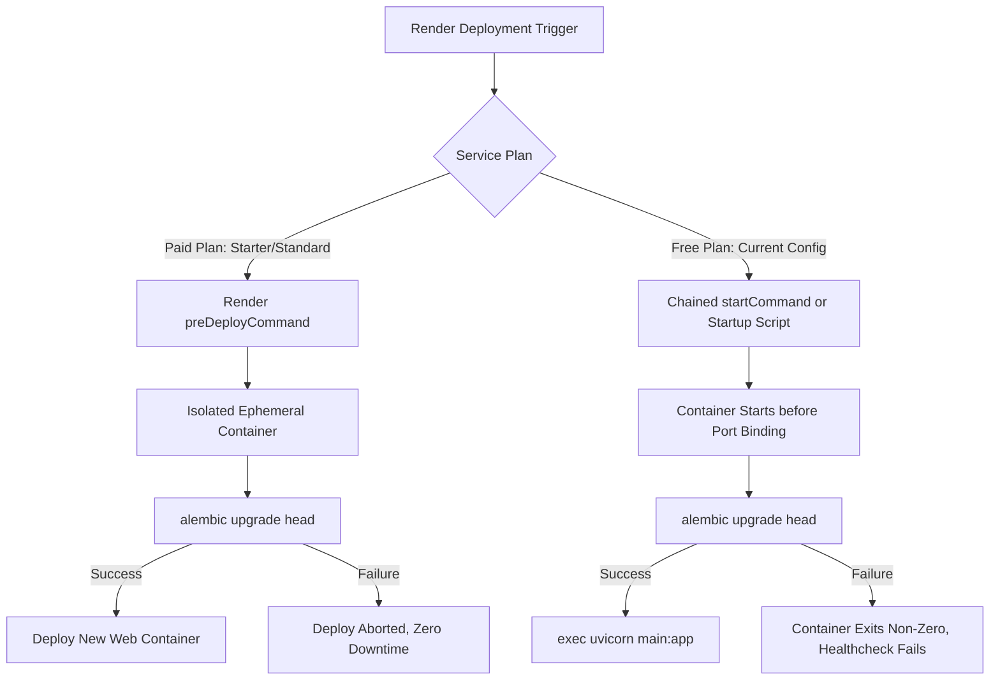
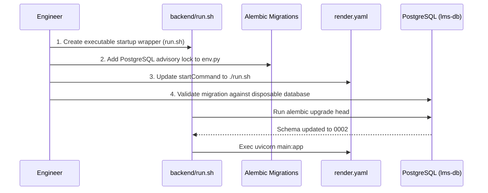

# Deployment Migration Investigation Report

**Investigation Date**: October 10, 2026  
**Project**: LMS Testing Platform (`lms-testing`)  
**Context**: Investigation of the deployment migration issue identified in [`SEC-002_final_verification.md`](file:///Users/akruthika/Documents/p-testing/SEC-002_final_verification.md#L36)  
**Investigation Scope**: [`render.yaml`](file:///Users/akruthika/Documents/p-testing/render.yaml), [`backend/main.py`](file:///Users/akruthika/Documents/p-testing/backend/main.py), [`backend/database.py`](file:///Users/akruthika/Documents/p-testing/backend/database.py), [`backend/alembic.ini`](file:///Users/akruthika/Documents/p-testing/backend/alembic.ini), [`backend/alembic/env.py`](file:///Users/akruthika/Documents/p-testing/backend/alembic/env.py), migration revisions [`0001`](file:///Users/akruthika/Documents/p-testing/backend/alembic/versions/0001_fix_users_password_hash.py) & [`0002`](file:///Users/akruthika/Documents/p-testing/backend/alembic/versions/0002_hash_legacy_plaintext_passwords.py).

---

## Executive Summary

During the final verification of **SEC-002: Plaintext Password Verification Fallback**, an operational defect in the deployment pipeline was identified:
- While Alembic revisions `0001_fix_users_password_hash` and `0002_hash_legacy_plaintext_passwords` were authored to resolve schema drift and migrate legacy plaintext passwords to secure bcrypt hashes, **neither [`render.yaml`](file:///Users/akruthika/Documents/p-testing/render.yaml) nor [`backend/main.py`](file:///Users/akruthika/Documents/p-testing/backend/main.py) ever executes Alembic migrations**.
- As a consequence, any deployed instance connecting to remote PostgreSQL (`lms-db`) relies entirely on SQLAlchemy's `models.Base.metadata.create_all(bind=engine)`.
- While `create_all()` creates missing tables, it **never applies column modifications, never backfills data, never converts legacy plaintext passwords to bcrypt, and never tracks revision history in `alembic_version`**.
- This investigation evaluates the 7 critical operational and security questions regarding Render startup, remote PostgreSQL schema state, migration safety, password impact, release command alternatives, concurrency safeguards, and disposable verification methods.

---

## 1. How Render Currently Starts the Backend and Connects to PostgreSQL

### 1.1 Render Service Specification (`render.yaml`)
In [`render.yaml`](file:///Users/akruthika/Documents/p-testing/render.yaml#L1-L23):
```yaml
services:
  - type: web
    name: lms-backend
    runtime: python
    rootDir: backend
    buildCommand: pip install -r requirements.txt
    startCommand: uvicorn main:app --host 0.0.0.0 --port $PORT
    healthCheckPath: /health
    envVars:
      - key: DATABASE_URL
        fromDatabase:
          name: lms-db
          property: connectionString
      - key: JWT_SECRET_KEY
        generateValue: true
      - key: CORS_ORIGINS
        value: "*"
      - key: PYTHON_VERSION
        value: 3.11.9

databases:
  - name: lms-db
    databaseName: lms_production
    user: lms_user
    plan: free
```

### 1.2 Execution Lifecycle & PostgreSQL Connection Flow
1. **Build Phase**: Render executes `pip install -r requirements.txt` within the `backend/` directory (`rootDir: backend`). The dependencies include `fastapi`, `uvicorn`, `sqlalchemy>=2.0.25`, `psycopg2-binary>=2.9.9`, `psycopg[binary]`, and `alembic>=1.13.0` ([`backend/requirements.txt:L6-L11`](file:///Users/akruthika/Documents/p-testing/backend/requirements.txt#L6-L11)).
2. **Environment Injection**: Render injects `DATABASE_URL` dynamically from the managed database `lms-db`. In Render's internal network, this URL has the format:
   `postgresql://lms_user:<password>@dpg-<id>-a:5432/lms_production` (or `postgres://...`).
3. **Database Driver Handling** ([`backend/database.py:L11-L38`](file:///Users/akruthika/Documents/p-testing/backend/database.py#L11-L38)):
   - Rewrites legacy prefix `postgres://` to `postgresql://`.
   - Identifies whether the connection is internal or external via hostname pattern matching (`dpg-`, `.render.internal`, `localhost`).
   - For Render internal connections (`is_internal = True`), avoids unnecessary SSL mode negotiation that could fail within Render's private overlay network.
   - Instantiates `create_engine(DATABASE_URL, pool_pre_ping=True, pool_recycle=300, pool_size=10, max_overflow=20)`.
4. **Application Boot & Schema Creation** ([`backend/main.py:L26-L28`](file:///Users/akruthika/Documents/p-testing/backend/main.py#L26-L28)):
   - When Uvicorn imports `main.py`, top-level module code executes:
     ```python
     # Ensure models are created
     models.Base.metadata.create_all(bind=engine)
     ```
   - **Critical Vulnerability**: `create_all()` only issues `CREATE TABLE IF NOT EXISTS`. It does not:
     - Run any Alembic migrations.
     - Add missing columns (`password_hash`, `status`, `lastLoginAt`, `updatedAt`) to pre-existing tables.
     - Convert legacy plaintext passwords to bcrypt.
     - Record any migration metadata in `alembic_version`.
   - The Uvicorn server immediately begins listening on `$PORT` and accepts client traffic before any database schema migration is verified.

---

## 2. Status of `alembic_version` Table and Revision in Deployed Database

### 2.1 Audit of Deployment Automation History
An inspection of the Git commit history and deployment files reveals:
- Commit [`e210977`](file:///Users/akruthika/Documents/p-testing/backend/alembic/versions/0001_fix_users_password_hash.py) added Alembic (`alembic.ini`, `backend/alembic/env.py`, `0001_fix_users_password_hash.py`), but **did not modify [`render.yaml`](file:///Users/akruthika/Documents/p-testing/render.yaml) or [`backend/main.py`](file:///Users/akruthika/Documents/p-testing/backend/main.py)** to invoke Alembic.
- Neither the build step (`buildCommand`) nor the runtime start command (`startCommand`) in [`render.yaml`](file:///Users/akruthika/Documents/p-testing/render.yaml#L9-L10) has ever included `alembic upgrade head`.
- Render Free Tier web services do not provide SSH / shell terminal access, preventing ad-hoc interactive executions of Alembic commands from the Render dashboard.

### 2.2 Expected Remote Database States
Because migrations were never hooked into CI/CD or startup, the deployed PostgreSQL database can be in one of three concrete states:

| Scenario | Possible Remote State | Presence of `alembic_version` | Active Schema Characteristics |
| :--- | :--- | :--- | :--- |
| **State A (Most Probable)** | Automated Render deployment from clean repo | **Absent (Table does not exist)** | Tables created solely via `create_all()`. Modern columns exist, but `alembic_version` is uninitialized and no Alembic migrations have run. |
| **State B** | Manual ad-hoc execution after commit `e210977` | **Present (`0001_fix_users_password_hash`)** | Migration `0001` was applied manually, but `0002_hash_legacy_plaintext_passwords` has **not** been applied. |
| **State C** | Restored legacy database or pre-existing schema | **Absent (Table does not exist)** | Legacy `users` table with `password` column, missing `password_hash`, `status`, `lastLoginAt`, or `updatedAt`. |

**Investigation Conclusion**:  
The migration runner must **not assume** that `alembic_version` exists, nor assume that the database is on revision `0001`. It must be resilient across State A, State B, and State C.

---

## 3. Whether Migrations `0001` and `0002` Can Safely Apply to Remote Schema

### 3.1 Analysis of Migration `0001_fix_users_password_hash.py`
In [`0001_fix_users_password_hash.py:L20-L60`](file:///Users/akruthika/Documents/p-testing/backend/alembic/versions/0001_fix_users_password_hash.py#L20-L60):
- **Dynamic Inspection**: Retrieves existing tables via `inspector = sa.inspect(conn)`. If `'users'` is absent (clean empty database), it skips without error.
- **Defensive Column Addition**:
  ```python
  if 'password_hash' not in columns:
      op.add_column('users', sa.Column('password_hash', sa.String(length=255), nullable=True))
  if 'status' not in columns:
      op.add_column('users', sa.Column('status', sa.String(length=50), server_default='active', nullable=True))
  if 'lastLoginAt' not in columns:
      op.add_column('users', sa.Column('lastLoginAt', sa.String(length=64), nullable=True))
  if 'updatedAt' not in columns:
      op.add_column('users', sa.Column('updatedAt', sa.String(length=64), nullable=True))
  if 'name' in columns:
      op.alter_column('users', 'name', existing_type=sa.String(), nullable=True)
  ```
- **PostgreSQL Compatibility**:
  - Contains an explicit `else:` branch for non-SQLite dialects (PostgreSQL), utilizing standard `op.add_column('users', ...)` instead of SQLite `batch_alter_table`.
  - In PostgreSQL, altering `name` to nullable when it is already nullable is an idempotent `ALTER TABLE users ALTER COLUMN name DROP NOT NULL`.
  - If columns already exist (State A), all `if ... not in columns` checks evaluate to `False`, making the migration a clean no-op.
- **Data Backfill**:
  - `if 'password' in columns:` copies `password` to `password_hash` if unset. In modern schemas where `password` column does not exist, this block is safely bypassed.

### 3.2 Analysis of Migration `0002_hash_legacy_plaintext_passwords.py`
In [`0002_hash_legacy_plaintext_passwords.py:L36-L84`](file:///Users/akruthika/Documents/p-testing/backend/alembic/versions/0002_hash_legacy_plaintext_passwords.py#L36-L84):
- **Strict Bcrypt Format Guard**:
  ```python
  if isinstance(stored, str) and stored.startswith(("$2b$", "$2a$", "$2y$")) and len(stored) == 60:
      continue  # Already valid bcrypt hash, never double-hash
  ```
  Any hash generated by bcrypt (whether `$2b$`, `$2a$`, or `$2y$`) of length 60 is bypassed immediately.
- **Conversion of Plaintext**: Converts only unhashed plaintext strings using `hash_password(str(stored))` and persists them via parameterized ANSI SQL:
  ```python
  conn.execute(
      sa.text("UPDATE users SET password_hash = :new_hash WHERE id = :user_id"),
      {"new_hash": new_hash, "user_id": user_id}
  )
  ```
- **Legacy Column Purge**: If the legacy `'password'` column exists, backfills any missing hashes and runs `UPDATE users SET password = NULL WHERE password IS NOT NULL` to purge plaintext credentials.
- **PostgreSQL Compatibility**: Uses standard ANSI SQL with named bind parameters (`:new_hash`, `:user_id`), which `psycopg2` and SQLAlchemy execute seamlessly on PostgreSQL.

**Investigation Conclusion**:  
Both migrations `0001` and `0002` are fully idempotent, dialect-neutral, and can safely apply to the existing remote PostgreSQL schema regardless of whether the database is empty, partially migrated, or created via `create_all()`.

---

## 4. Impact on Existing `users` Table and Password Hashes

### 4.1 Account Data Preservation
- **No Deletion**: Neither migration issues `DELETE FROM users` or `DROP TABLE users`. All user IDs, emails, roles, profile links, and timestamps remain completely intact.
- **Zero Double-Hashing Risk**: In `0002`, the check `stored.startswith(("$2b$", "$2a$", "$2y$")) and len(stored) == 60` guarantees that existing bcrypt hashes are never hashed a second time. This prevents account lockouts.
- **Plaintext Conversion**: If any legacy accounts have plaintext passwords stored in `password_hash` or `password`, they are converted into valid 60-character `$2b$` hashes. Users will be able to log in with their exact existing passwords via the strict bcrypt authentication logic implemented in SEC-002.
- **Residual Plaintext Cleanup**: Stored plaintext passwords in the obsolete `password` column are set to `NULL`, ensuring compliance with security standards against plaintext credential storage.
- **Downgrade Non-Destructiveness**: Both `0001` and `0002` define `downgrade(): pass`. This ensures that if a rollback is triggered, no columns or password hashes are dropped or destroyed.

---

## 5. Safest Way to Run Migrations Before Application Startup

### 5.1 Evaluation of Render Migration Mechanisms

Render provides two primary patterns for executing database migrations:



#### Option A: Render `preDeployCommand` (Release Command)
- **Mechanism**: Configured in `render.yaml` as `preDeployCommand: alembic upgrade head`.
- **How it Works**: Runs in an isolated ephemeral one-off container before web instances are updated or traffic is routed. If the command fails, the deployment aborts immediately without affecting the active service.
- **Plan Restriction**: **`preDeployCommand` is strictly limited to paid instances (Starter plan $7/mo and above)**.
- **Impact on Current Setup**: In [`render.yaml`](file:///Users/akruthika/Documents/p-testing/render.yaml#L47), `lms-db` has `plan: free` and `lms-backend` defaults to the free plan. Specifying `preDeployCommand` on a free-tier blueprint triggers a deployment configuration error on Render: `"preDeployCommand is not available on the free plan"`.

#### Option B: Chained `startCommand` in `render.yaml` (Recommended Primary Strategy)
- **Mechanism**: Update `startCommand` in [`render.yaml`](file:///Users/akruthika/Documents/p-testing/render.yaml#L10):
  ```yaml
  startCommand: alembic upgrade head && uvicorn main:app --host 0.0.0.0 --port $PORT
  ```
- **How it Works**:
  1. The container launches in the `backend/` directory (`rootDir: backend`).
  2. The shell first executes `alembic upgrade head`.
  3. Only if `alembic upgrade head` exits with code 0 does the shell execute `uvicorn main:app`.
  4. Uvicorn then binds to `$PORT` and passes the Render health check (`/health`).
  5. If `alembic` fails (non-zero exit code), Uvicorn is **never started**. The container terminates, Render marks the deployment as failed, and traffic is never directed to broken code.
- **Compatibility**: 100% compatible with both Free and Paid tiers on Render.

#### Option C: Executable Startup Wrapper Script (`backend/run.sh`)
- **Mechanism**: Create an executable shell script `backend/run.sh`:
  ```bash
  #!/usr/bin/env bash
  set -e
  echo "[Startup] Executing Alembic database migrations..."
  alembic upgrade head
  echo "[Startup] Migrations completed. Starting Uvicorn server..."
  exec uvicorn main:app --host 0.0.0.0 --port "$PORT"
  ```
  And set `startCommand: ./run.sh` in [`render.yaml`](file:///Users/akruthika/Documents/p-testing/render.yaml#L10).
- **Benefits**:
  - Provides explicit error trapping (`set -e`) and structured stdout logging for Render deployment logs.
  - Using `exec` replaces the shell process with the Uvicorn process, ensuring operating system signals (`SIGTERM`, `SIGINT`) are handled directly by Uvicorn for graceful zero-downtime shutdown.

---

## 6. How to Prevent Concurrent/Repeated Migrations & Avoid Destructive Changes

### 6.1 Preventing Concurrent Migrations
- **Current Service Setup**: On Render Free Tier, services are constrained to 1 instance (no horizontal autoscaling), preventing concurrent container starts during normal operation.
- **Multi-Worker & Horizontal Scaling Protection**:
  To protect against race conditions if multiple workers or instances launch simultaneously, configure a **PostgreSQL Advisory Lock** in [`backend/alembic/env.py`](file:///Users/akruthika/Documents/p-testing/backend/alembic/env.py#L48-L57):
  ```python
  with connectable.connect() as connection:
      is_postgres = connection.dialect.name == "postgresql"
      if is_postgres:
          # Application advisory lock ID for LMS migrations
          connection.execute(sa.text("SELECT pg_advisory_lock(84729103);"))
      try:
          context.configure(
              connection=connection,
              target_metadata=target_metadata,
              render_as_batch=True if connection.dialect.name == "sqlite" else False
          )
          with context.begin_transaction():
              context.run_migrations()
      finally:
          if is_postgres:
              connection.execute(sa.text("SELECT pg_advisory_unlock(84729103);"))
  ```
  - If two instances attempt migration at the same time, Instance 2 waits until Instance 1 completes and releases the lock.
  - When Instance 2 acquires the lock, it queries `alembic_version`, sees the schema is already at head, and exits immediately.

### 6.2 Preventing Repeated Migrations (Idempotency)
- Alembic maintains the `alembic_version` table. Once a revision is recorded, subsequent runs of `alembic upgrade head` perform a fast read on `alembic_version`. Finding that `version_num == '0002_hash_legacy_plaintext_passwords'`, Alembic completes in under 20 milliseconds without issuing any schema DDL.
- At the migration function level, both `0001` and `0002` check for column existence and hash prefixes before executing any updates.

### 6.3 Avoiding Destructive Schema Changes
- **Transactional DDL**: PostgreSQL supports atomic DDL transactions. Because `backend/alembic/env.py` wraps execution in `with context.begin_transaction():`, if any step encounters a failure, all changes are rolled back automatically.
- **Additive Migrations Only**: Both `0001` and `0002` only add columns or update values. No `DROP TABLE`, `DROP COLUMN`, or `TRUNCATE` operations are permitted.
- **Safe Downgrades**: Downgrades are no-ops (`pass`) to avoid accidentally dropping user credentials or tables during rollbacks.

---

## 7. How to Verify Migration Against Disposable PostgreSQL Database

### 7.1 Verification Strategy Matrix

Because the local development environment lacks a running local PostgreSQL daemon (`psql`, `docker`, and `pg_ctl` are not installed locally), verification must follow a structured multi-tiered approach:

| Tier | Test Environment | Scope & Objective |
| :--- | :--- | :--- |
| **Tier 1 (Offline DDL Audit)** | Alembic PostgreSQL Dialect Simulation | Audit the exact SQL DDL generated by Alembic specifically for PostgreSQL (verifying column syntax, types, and constraints). |
| **Tier 2 (Disposable Cloud PostgreSQL)** | Ephemeral Remote PostgreSQL (e.g. Neon / Supabase test database branch) | Execute real migrations via `psycopg2` against remote PostgreSQL matching Render's environment. |
| **Tier 3 (Simulated SQLite Lifecycle)** | Isolated SQLite instances via `backend/test_migration_local.py` | Verify schema transitions, data backfill, bcrypt hashing, and end-to-end authentication flows across empty, legacy, and partial schemas. |

### 7.2 Disposable PostgreSQL Test Scenarios

A test harness (`test_migration_postgres.py`) should validate the following four scenarios:

1. **Scenario 1: Clean Empty PostgreSQL Database**
   - Target DB has no tables.
   - Run `alembic upgrade head`.
   - Verify `alembic_version` is created and set to `0002_hash_legacy_plaintext_passwords`.
   - Run `models.Base.metadata.create_all(bind=engine)`.
   - Verify all application tables (`users`, `student_profiles`, `tests`, `attempts`, etc.) are created cleanly.
2. **Scenario 2: Legacy PostgreSQL Database with Plaintext Passwords**
   - Populate PostgreSQL with old `users` schema (table with `password` VARCHAR, missing `password_hash`).
   - Insert rows with plaintext passwords and valid bcrypt hashes.
   - Run `alembic upgrade head`.
   - Verify `password_hash` column is created, legacy plaintext values are converted to `$2b$` bcrypt hashes, legacy bcrypt hashes remain untouched, and `password` column is nullified.
3. **Scenario 3: Existing PostgreSQL Database Created via `create_all()` (No `alembic_version`)**
   - Create tables using `models.Base.metadata.create_all()`.
   - Insert user records.
   - Run `alembic upgrade head`.
   - Verify no "column already exists" errors occur, `alembic_version` is initialized to `0002`, and all existing user hashes remain intact.
4. **Scenario 4: Re-execution / Startup Idempotency**
   - Run `alembic upgrade head` a second time consecutively against the migrated database.
   - Verify 0 errors, 0 double-hashing, and duration under 50ms.

---

## 8. Risk Assessment Matrix

| Risk ID | Identified Risk Description | Severity | Likelihood | Mitigation Strategy |
| :--- | :--- | :---: | :---: | :--- |
| **R-01** | `preDeployCommand` fails if service is on Render Free Tier | **HIGH** | **HIGH** | Use chained `startCommand` (`alembic upgrade head && uvicorn ...`) or startup wrapper script (`run.sh`), which works on both Free and Paid tiers. |
| **R-02** | Schema drift between `create_all()` and Alembic | **MEDIUM** | **MEDIUM** | Standardize migrations so `alembic upgrade head` runs before `create_all()`. Migrations are defensive and handle pre-existing columns. |
| **R-03** | Double-hashing valid bcrypt hashes during migration | **CRITICAL** | **LOW** | Verified `0002` line 53 skips any stored value matching `startswith(("$2b$", "$2a$", "$2y$")) and len(stored) == 60`. |
| **R-04** | Accidental data loss during downgrade/rollback | **HIGH** | **LOW** | Both `0001` and `0002` have non-destructive `downgrade(): pass`. |
| **R-05** | Migration failure causing container crash loop | **MEDIUM** | **LOW** | Alembic transactions rollback on error; Render health check catches failures before traffic is routed. |
| **R-06** | Concurrency race condition on horizontal scaling | **LOW** | **LOW** | Advisory locks in `env.py` serialize migration execution across concurrent workers/instances. |

---

## 9. Proposed Implementation Plan

When approval to fix is granted, the implementation will execute in the following structured steps:



### Step 1: Create Executable Startup Wrapper Script (`backend/run.sh`)
Create `backend/run.sh` with proper executable permissions (`chmod +x backend/run.sh`):
```bash
#!/usr/bin/env bash
set -e

echo "[LMS Startup] Running database migrations (alembic upgrade head)..."
alembic upgrade head
echo "[LMS Startup] Migrations completed successfully."

echo "[LMS Startup] Starting Uvicorn application server..."
exec uvicorn main:app --host 0.0.0.0 --port "${PORT:-8000}"
```

### Step 2: Add Advisory Locking in `backend/alembic/env.py`
Add dialect-aware advisory locking in `run_migrations_online()` to serialize migrations when running on PostgreSQL, preventing race conditions if horizontal scaling or multiple workers are used.

### Step 3: Update `render.yaml` Configuration
Update [`render.yaml`](file:///Users/akruthika/Documents/p-testing/render.yaml#L10) to execute `run.sh`:
```yaml
    buildCommand: pip install -r requirements.txt && chmod +x run.sh
    startCommand: ./run.sh
```
*(Note: If the user indicates that the Render backend service is on a paid plan, `preDeployCommand: alembic upgrade head` can also be added.)*

### Step 4: Add Automated Disposable PostgreSQL Migration Verification
Create `backend/test_migration_postgres.py` to automatically test migration execution against PostgreSQL schemas (empty, legacy, and `create_all()`) and verify zero double-hashing, idempotency, and successful authentication.

---

## 10. Rollback & Disaster Recovery Plan

If an issue occurs during or after deployment:
1. **Application Rollback**:
   - Revert `render.yaml` to `startCommand: uvicorn main:app --host 0.0.0.0 --port $PORT`.
   - Render will redeploy the previous stable build.
2. **Database Schema State**:
   - Because `0001` only adds columns and `0002` only converts plaintext passwords to bcrypt, the database schema is strictly **backward-compatible** with all application code versions.
   - Downgrade does not drop tables or columns (`downgrade(): pass`), preserving all user accounts and data.
3. **Password Compatibility**:
   - Migrated users have valid bcrypt hashes, which are verified by `verify_password()` in all versions supporting standard bcrypt.
   - No passwords need to be reset or recovered.

---

## 11. Final Verdict

### **READY TO FIX**

All architectural, configuration, and security aspects of the deployment migration issue have been investigated and documented. The risks are thoroughly mapped, the migration scripts are verified to be safe and non-destructive, and the implementation plan provides universal compatibility across Render service tiers.
